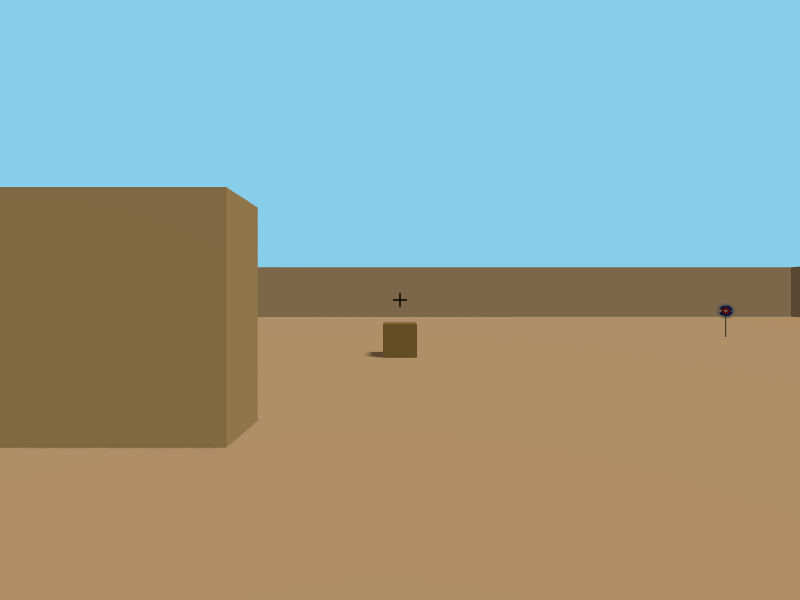

# FPS Demo — Dust 2 Inspired

**Every line of game code in this repository was written by a locally-hosted AI.**

The entire demo — a single self-contained `index.html` — was authored by [Codex CLI](https://github.com/openai/codex) driving **Qwen3.6-27B-FP8** served by vLLM on a single RTX 5090, running entirely on a home lab. No cloud model wrote any of the shipped code, no OpenAI account was involved (Codex ran against the local vLLM endpoint), and no human wrote or hand-edited a single line.



*(Screenshot captured by the automated verification harness's headless browser — software rendering, hence the modest fidelity. It looks better on a real GPU.)*

## Play it

Any static file server works:

```
python3 -m http.server 8080
```

Open `http://localhost:8080` — **click** to lock the mouse (and enable audio), **WASD** to move, **left-click** to fire, **ESC** to release the mouse.

## Features

- Three.js 0.160 (ES modules via import map, no build step, no dependencies beyond the CDN)
- Dust 2-style scene: warm directional sunlight with PCFSoft shadow mapping, sandy palette, walls and crates
- Competitive-style movement: delta-time based, instant acceleration/stop, per-axis AABB collision with wall sliding
- Hitscan shooting with raycast from screen center, impact decals (capped, oldest recycled), muzzle flash, geometric rifle viewmodel
- Recoil with smooth, framerate-independent recovery
- Fully procedural Web Audio sound — gunshots with per-shot variation, impact ticks, footsteps; no audio files
- Shooting range: bullseye targets that react to hits, and patrolling dummy players that fall when shot and respawn

## How it was built

The project was split into six milestones (scene/lighting, movement/collision, weapon/hitscan, recoil/polish, procedural audio, shooting range). An autonomous pipeline — a local LibreChat coordinator agent driving Codex over MCP — implemented each milestone, and a headless-browser verification suite had to pass before any milestone was accepted: it measures real movement vectors, collision containment, hitscan registration, recoil curves, sound triggers, and even aims at targets and dummies using positions the game reports and expects the hits to land.

The git history is the provenance: each `milestone N verified` commit is a checkpoint that passed the full suite. One bug shipped and was caught after release of milestone 4 — the movement basis was rotated 90° (a classic coordinate-convention slip) — diagnosed by the same test hook and fixed by the same local model in the `fix movement basis` commit.

The milestone specs and verification harness were external scaffolding around the model; the shipped code itself is entirely local-model output.

Built 2026-07-17.
